# Live Classroom

The teacher-led live class: webcam and screen share, a shared whiteboard, raised hands,
roles and permissions, Adobe Connect–style layouts, a watermark that identifies every viewer,
and screen capture that is blocked or censored. Recording happens on the server only and
feeds the library through the contract in [06-recording-pipeline.md](06-recording-pipeline.md).

Owner: the live-classroom session. Code lives in `services/live`, `packages/tihe_classroom`,
`packages/capture_guard` and `packages/contracts/src/live`.

Decisions behind this document: [ADR-0009](adr/0009-four-platforms-classroom-desktop-first.md)
(platforms), [ADR-0010](adr/0010-classroom-control-plane-websocket-gateway.md) (control plane),
[ADR-0011](adr/0011-live-capture-guard-censor-and-attribute.md) (capture),
[ADR-0012](adr/0012-services-live-client-facing-own-database.md) (service boundary).

---

## 1. Moving parts

```
 Flutter app (tihe_classroom)                       services/live (NestJS)
 ┌──────────────────────────────┐   REST /v1/live   ┌────────────────────────────────┐
 │ join → LiveKit token, ticket │──────────────────►│ classes · sessions · join      │
 │ stage: pods in a layout      │                   │ LiveKit tokens / rooms / egress│
 │ whiteboard · chat · hands    │   WSS /v1/live/ws │ classroom gateway (room actor) │
 │ capture_guard · watermark    │◄─────────────────►│ audit · attendance             │
 └──────────────┬───────────────┘                   └──────┬─────────────────┬───────┘
                │ WebRTC media only                        │ server API       │ Redis
         ┌──────▼──────────┐   room composite (template)   │                  │
         │ LiveKit SFU     │◄──────────────────────────────┘           Postgres tihe_live
         │ + Egress        │──► s3://tihe-raw/recordings/{classId}/{sessionId}/
         └─────────────────┘       composite.mp4 + metadata.json  ──► video pipeline
```

- **LiveKit carries media only**: camera, microphone and screen share. Data channels are
  switched off for everyone (`canPublishData=false`).
- **The gateway carries everything else**: permissions, hands, layout, chat, whiteboard,
  capture reports. It is server-authoritative, so every rule is checked once, on the
  server. See ADR-0010.
- **Media rights are enforced by the SFU**. When a capability changes, the gateway pushes
  `canPublishSources` to LiveKit, so a client that ignores the UI still cannot publish.

## 2. Classes and sessions

A **class** (`cls_…`) is the recurring thing: "Calculus 1, Saturdays 10:00", attached to one
course. A **session** (`ses_…`) is one occurrence of it. The LiveKit room is named after the
session id, so a weekly class never reuses a room.

Session states: `scheduled → live → ended`. The host starts the session, which creates the
room and, if `autoRecord` is on (the default), starts recording immediately. Ending the
session stops recording, closes the room and disconnects everyone.

## 3. Roles and capabilities

| Role | Persian | Who | Default capabilities |
|---|---|---|---|
| `host` | میزبان | the course teacher, admins | everything |
| `cohost` | دستیار | teaching assistants | media, screen, board (+manage), chat, manage participants, change layout |
| `presenter` | ارائه‌دهنده | a student given the stage | media, screen, board (+manage), chat |
| `participant` | شرکت‌کننده | enrolled students | raise hand, chat — plus whatever the room policy allows |
| `recorder` | — | Egress (hidden) | subscribe only |

Capabilities:

| Capability | Persian | Means |
|---|---|---|
| `publish.audio` | میکروفون | publish microphone |
| `publish.video` | دوربین | publish camera |
| `publish.screen` | اشتراک صفحه | publish screen share |
| `whiteboard.draw` | نوشتن روی تخته | add and erase own board items |
| `whiteboard.manage` | مدیریت تخته | erase anyone's items, clear, add/switch pages |
| `chat.send` | ارسال پیام | send chat messages |
| `hand.raise` | بالا بردن دست | raise a hand |
| `participants.manage` | مدیریت شرکت‌کنندگان | mute, lower hands, grant/revoke, remove, change room policy, see capture alerts, read private chat |
| `roles.assign` | تعیین نقش | change someone's role |
| `layout.change` | تغییر چیدمان | change the stage layout |
| `recording.control` | کنترل ضبط | start/stop recording |
| `class.end` | پایان کلاس | end the session |

**Room policy** (host-editable toggles that apply to the `participant` role only):
`participantsCanUnmute`, `participantsCanStartVideo`, `participantsCanShareScreen`,
`participantsCanDraw`, `participantsCanChat` (on by default), `handRaiseEnabled` (on by
default), `locked` (no new joins below cohost), `privateChat` (off by default; see below).

**Effective capabilities** = role preset ∪ policy (participants only) ∪ per-user grants −
per-user revokes. Rules, all enforced in `services/live/src/core/capabilities.ts` and tested:

1. A host's capabilities can never be revoked.
2. Nobody can grant a capability they do not hold themselves.
3. You can only change someone of a lower rank (`host > cohost > presenter > participant`).
4. Only `roles.assign` holders change roles, and the last host cannot be demoted.

### Private chat (گفتگوی خصوصی)

An optional mode, not a fixed behaviour: the `privateChat` toggle of the room policy, off by
default. The managers (everyone with `participants.manage`: the host, which is the course teacher
or an admin, and cohosts) switch it from "class settings" at any moment of a live class, with
`policy.update`; the server refuses that command from anyone else. A teacher can also make it the
default for the class's next sessions (`PATCH /v1/live/classes/:id`, hosts only).

While it is on:

- **Students keep writing.** Each message from someone without `participants.manage` (a
  participant, or a presenter: a student given the stage) is stamped `private` by the server and
  reaches **its sender and the managers only**. No other student receives it: not live, not in
  the snapshot after a refresh, not in the replay after a reconnect, not as a `chat.deleted`. The
  recorder receives nothing private.
- **The managers speak to everyone.** Their messages stay public, so a teacher can answer a
  private question for the whole class.
- **The sender has no say.** `chat.send` carries no audience. The server sets the flag from the
  mode and the sender's capabilities when the message is sent, and never changes it: turning the
  mode off does not publish what was private, and turning it on does not hide what was public.
- **Who reads private chat is answered by roles alone**, because `participants.manage` cannot be
  granted or revoked by itself. It is checked whenever a message is delivered, so a student
  promoted to cohost reads private messages from then on, and a demoted cohost stops (their app
  drops the ones it held, too).
- `chat.delete` on someone else's private message answers `NOT_FOUND`, so an id cannot be probed.
- **Everyone is told.** The switch reaches every client as `policy.updated`, and each app shows a
  notice when it flips. The chat pod shows a strip: to a student, that only the host and
  assistants see their messages; to a manager, that participants' messages reach only managers
  while theirs reach everyone. Private messages carry a "خصوصی" pin.
- Reactions are chat messages (§11), so a student's reaction floats only for them and the managers.
- As with other personal events, a student sees a gap in sequence numbers where someone else's
  private message went by.

The rule is one function, `canSeeMessage`, plus the event audience `{ managersAnd: senderId }`
(`reaches`), both in `services/live/src/core` and tested there and end to end over the gateway.
The final snapshot kept in Postgres holds every message with its flag; no endpoint serves it.

**Compared with Skyroom and Adobe Connect.** Skyroom's chat menu has a private mode (حالت خصوصی)
that behaves like this one: while the operator has it on, users' messages are seen by the
operator and the presenter only. Skyroom's operator and presenter are the teaching staff, so here
they map to the managers (host and cohost), not to our `presenter` role. Adobe Connect has no
room-wide equivalent. Its "private chat" preference ("Allow participants to chat privately")
governs direct messages between attendees, and an attendee's message reaches only the hosts when
the attendee picks the Hosts tab: the sender chooses. Here the class chooses, so a student cannot
opt out of it, and there are no direct messages between students at all.

## 4. Raised hands

- Hands form a queue ordered by the server sequence number at the time of raising, never by
  client clocks.
- A participant lowers their own hand; managers lower anyone's, or all at once.
- **Accepting** a hand ("give the floor") lowers it and adds temporary grants of
  `publish.audio` (and `publish.video` if the host chose "with camera"). The server can mute
  but cannot unmute, so the student's app shows "you may speak" and they unmute themselves.
- **Taking back the floor** removes those grants and mutes the tracks.

## 5. Layouts

A layout is a set of **pods** placed on a 12 × 12 grid. Pod kinds:

| Kind | Persian | Content |
|---|---|---|
| `speaker` | ارائه‌دهنده | the host / active speaker, large |
| `gallery` | تصاویر | camera grid of everyone publishing video |
| `screen` | اشتراک صفحه | the current screen share |
| `whiteboard` | تخته سفید | the shared board |
| `chat` | گفتگو | chat |
| `participants` | شرکت‌کنندگان | participant list with roles and controls |
| `hands` | دست‌های بالا | the raised-hand queue |

Coordinates are measured from the **start edge**, so a layout written once renders correctly
in RTL, where the start edge is on the right. Validation rules: every pod lies inside the
grid, no two pods overlap, ids are unique, each kind appears at most once, and there are
between 1 and 8 pods.

### Recommended layouts

| Key | Name | Pods (x, y, w, h) | For |
|---|---|---|---|
| `lecture` | سخنرانی | speaker 0,0,8,12 · chat 8,0,4,7 · participants 8,7,4,5 | talking-head lectures |
| `presentation` | ارائه | screen 0,0,9,12 · speaker 9,0,3,4 · chat 9,4,3,8 | slides, software demos |
| `whiteboard` | تخته سفید | whiteboard 0,0,9,12 · speaker 9,0,3,4 · chat 9,4,3,8 | solving problems by hand |
| `discussion` | گفتگو | gallery 0,0,9,12 · chat 9,0,3,7 · hands 9,7,3,5 | seminars, group talk |
| `split` | ترکیبی | screen 0,0,6,8 · whiteboard 6,0,6,8 · speaker 0,8,3,4 · gallery 3,8,6,4 · chat 9,8,3,4 | annotating alongside slides |
| `qa` | پرسش و پاسخ | speaker 0,0,7,8 · gallery 0,8,7,4 · hands 7,0,5,5 · chat 7,5,5,7 | end-of-class questions |

The host (or anyone with `layout.change`) picks a preset or applies a custom layout from the
layout editor. Everyone's stage follows it. Custom layouts are saved per teacher
(`/v1/live/layouts`). A viewer can still maximise a pod on their own screen; that is local
and never synced.

**Small screens** (phones, under 600 logical pixels wide): the layout collapses to its largest
media pod, with the other pods behind a tab bar.

**Recording layout**: Egress renders the same layout **minus** the chat, participant and
hands pods, so no student names end up in the library video. The largest remaining media pod
takes the main area and the rest stack in a side column
(`deriveRecordingLayout` in `packages/contracts/src/live/layout.ts`, shared by the service and
the Egress template).

## 6. Whiteboard

- **Pages**: a board has pages (plain, grid, lined or dotted backgrounds); the active page is
  synced. Page space is 16:9, stored as integers in `0..16000 × 0..9000`, so a stroke looks
  the same at any window size.
- **Tools**: pen (خودکار), marker (ماژیک), highlighter (ماژیک فسفری, translucent), eraser
  (پاک‌کن — removes whole items), line, arrow, rectangle, ellipse, text, and laser pointer
  (لیزر — ephemeral, fades, never stored). Eight palette colours plus custom; widths in page
  units (1–640); optional fill for shapes.
- **Sync**: while drawing, the client sends `wb.progress` batches about every 40 ms. They are
  relayed to others as a live preview, never stored, and may be dropped under backpressure.
  On pen-up it sends `wb.add` with the finished item, which the server sequences and
  persists.
- **Undo/redo** is per user and implemented as inverse operations (`wb.remove` ↔
  `wb.restore`), so it never disturbs anyone else's work.
- **Ownership**: `whiteboard.draw` lets you erase your own items only; `whiteboard.manage`
  erases anything, clears pages and switches pages for everyone.
- **Rendering**: strokes are outlined with the perfect-freehand algorithm — `perfect_freehand`
  in Dart, `perfect-freehand` in the Egress template — so the recording matches the live
  board.
- **Text direction**: each text item takes its direction from its first strong character, so
  a Persian note reads right to left and a formula like `f′(g(x))` reads left to right in
  both. Either way it is right-aligned at its anchor, `at`, which is the item's top-right
  corner. The rule is `textDirectionOf`, in both the Flutter painter and the template.
- Limits: 2000 points per stroke (the client splits longer ones), 10 000 items per page, 500
  characters per text item.

## 7. Webcam, microphone and screen share

- Camera and mic via `livekit_client` with simulcast and adaptive streaming, so a 100-person
  gallery only receives the resolutions actually on screen. On desktop the chevron beside the
  microphone and camera keys picks the device (`ClassroomMedia.devices` / `selectDevice`); on
  mobile the operating system chooses, front and back cameras included.
- **Screen share**:
  - **Windows / macOS**: a picker listing screens and windows, with thumbnails. The classroom's
    own window is left out of the list. On macOS the picker defaults to "window", because a
    full-screen share would show the classroom inside itself (see §8).
  - **Android**: MediaProjection with the required foreground service
    (`FOREGROUND_SERVICE_MEDIA_PROJECTION` on Android 14+).
  - **iOS**: a Broadcast Upload Extension (ReplayKit) sharing the app group with the app.
  - **Quality**: 1080p at up to 30 fps, capped at 3 Mbps (LiveKit's preset allows 5; many
    teachers' uploads cannot carry that). When bandwidth runs short, WebRTC keeps a screen
    share's resolution and drops frames instead, so slide text stays sharp.
- **Known gap**: native `livekit_client` does not capture system audio with a screen share. A
  teacher playing a clip must route audio through a virtual audio device into the microphone
  for now. A native loopback plugin (WASAPI on Windows, ScreenCaptureKit audio on macOS) is
  the planned fix.

## 8. Capture protection — "screen recording is banned"

Policy: **block where the OS allows it, detect where it doesn't, censor on detection, alert
the host, and watermark always**. Full reasoning in ADR-0011.

| Platform | Block | Detect | What a recording shows |
|---|---|---|---|
| Windows | `SetWindowDisplayAffinity`: `WDA_MONITOR` for students, `WDA_EXCLUDEFROMCAPTURE` for presenters | known recorder processes; Remote Desktop session | students' window: **black box**; presenters' window: absent from their own share |
| macOS | `NSWindow.sharingType = .none` | known recorder processes; `screencaptureui` | macOS ≤ 14: window blank. **macOS 15+: ScreenCaptureKit ignores `sharingType`, so detection + censor is the only barrier** |
| Android | `FLAG_SECURE` while the classroom is on screen | Android 15 screen-recording callback, Android 14 screenshot callback | black |
| iOS | secure-layer rendering (behind a server flag) | `sceneCaptureState` / `isCaptured`, screenshot notification, external screens | censored layer |

**On detection** the student's classroom is replaced by the censor screen ("ضبط صفحه در
کلاس مجاز نیست"), and remote audio is muted too (`censorAudio`) — pixel blocking never covers
audio. The app reports `capture.report` to the gateway, which writes an audit event and alerts
everyone with `participants.manage`. The content comes back when recording stops. No
auto-kick; the host decides.

**Self-capture is not an offence**: a presenter's own screen share uses the same OS machinery
(MediaProjection, ReplayKit, desktop capture). The client suppresses detection while its own
share is active and, on iOS, only when there is a single screen (AirPlay mirroring also sets
"captured").

The recorder-process list and flags come from the server in the join response, so they can
be tuned without an app release.

## 9. Watermark

- **Text**: two rows, as the institute asked — the viewer's first and last name, and beneath
  it their **whole** phone number in its local form — and nothing else, no short id and no
  clock:

  ```
  علی کریمی
  09121234503
  ```

  Every digit is legible, so a leaked copy names its source without a lookup. The number uses
  ASCII digits, is the larger row and is letter-spaced, so OCR on a blurry camera copy reads
  it; the name reads right to left and the number left to right, each on its own row, so no
  digit reorders. `liveWatermarkText` in contracts builds the text; without a name it is the
  number alone. The directory sends the whole number (`phone` in `directoryProfileSchema`)
  for this and nothing else. Opacity 0.4, so the digits read on the white board too.
- **Placement**: one mark, over the **stage** (not the window, since a camera aimed at the
  slides would crop the window edges), in exactly one of five spots: the four corners of the
  stage or its centre, with both rows hugging the corner they are in. It jumps to a different
  spot at seeded random intervals — 0.5–1.5 × a per-join period of 20–35 s
  (`movement: 'corners-and-center'`, `WatermarkHopper` in the classroom; a server that still
  sends `corners` gets the four corners). The centre is there because a camera zoomed in past
  the corners cropped a corners-only mark out. It does not glide: it leaves one spot at once
  and drops into the next with a small bounce, so it is never seen crossing the stage; under
  the system's reduce-motion setting it simply appears there. The jumps are timed on a
  monotonic stopwatch, so winding the device's clock back cannot freeze the mark in one spot.
- **Rendering**: a Flutter overlay above the stage. In the classroom the video is a Flutter
  texture, so a Dart overlay sits above it exactly as a native layer would (ADR-0011).
- **Privacy**: the whole number goes only to its owner, in their own join response, and is
  drawn only on their own screen. It is never placed in LiveKit metadata or attributes, the
  gateway or a gateway ticket, which other participants can read, and never logged (logs mask
  it, CLAUDE.md rule 2). The e2e test checks that one student's number reaches no one else.
  - **While they share their own screen** the number on their mark is masked
    (`0912•••4503`), the name staying: their classroom window can end up in that share — on
    macOS 15+, where `sharingType` is ignored; in a course with `allowCapture`, where nothing
    is blocked; on iOS without the secure layer — and the share goes to the whole class and
    into the recording. It comes back in full when they stop (`WatermarkOverlay.ownShare`).
- **Recordings** carry an institute mark instead. Viewer identity is added by the player when
  a recording is watched.

## 10. Recording

Server-side Egress only; the app has no recording path. Egress renders
`services/live/egress-template` — the same layout (minus private pods), the whiteboard and
the institute mark — and writes to the path fixed in docs/06. A pulsing red "در حال ضبط" pill is
visible to everyone while recording.

The template draws the page and its finished ink into an offscreen canvas when an event changes
them, and each frame copies that and draws only the strokes in progress. Redrawing every stroke
each frame took about 45 ms a frame on a 300-stroke page in headless Chrome — more than the
recorder's frame budget, so recordings stuttered while the teacher wrote.

Ordering that matters for the pipeline:
1. `metadata.json` is written at egress start and rewritten with `actualEndAt` and
   `participantCount` **before** `stopEgress` is called, so ingest never reads a stale copy.
2. Egress cannot pause. Stopping and starting again would overwrite `composite.mp4`, so v1
   records the whole session. Multi-part recordings need a contract change (docs/06).

## 11. Look and language

This design is the institute's choice for every version of every app, and it is locked
(CLAUDE.md, rule 11): `packages/tihe_classroom/test/design_lock_test.dart` pins its colours, its
font, its cursor, its mark and its plain sky (no planets or other circles, since 2026-10-18), so a
change to any of them is a decision taken in a pull request, never the side effect of a merge or
a refactor.

- Persian, right-to-left, everywhere in the classroom: Persian digits in the UI, Jalali dates,
  and Persian error messages from `messageFa`.
- **Font: Modam** (مُدام, by Naser Khadem, FontIran), all eight weights of its standard cut, in
  `packages/tihe_classroom/assets/fonts/`. They are registered at runtime as the family `Modam`
  (`ClassroomFonts`), which the example app does before its first frame. The standard cut keeps
  Latin digits, which addresses, ids and board formulas need; the UI turns its own numbers into
  Persian digits. The few characters Modam lacks ("…", "·", "²", emoji) come from the fallback
  fonts and the platform. The recording template uses the same files, so recordings match.
  Modam is commercial: the institute's FontIran licence must cover embedding it in the app.
- **Navy glass, in dark and light.** The classroom is layers — pods over the stage, the dock and
  sheets over pods — and frosted glass keeps each layer's place readable without heavy borders
  or shadows:
  - Sky: a deep navy gradient (pale blue in the light theme), painted once, with nothing drawn
    on it. It used to carry soft glows, two lit planets with orbit lines and a moon; the
    institute asked for the circles to go, and the design-lock test now pins a sky without
    them.
  - Panes: every pod, the top bar's chips and the dock are frosted navy glass with a lit
    one-pixel rim. The stage's panes share one `BackdropGroup`, so seven pods cost one blur;
    overlays (toasts, sheets, menus) blur on their own.
  - Accent: one electric blue, as a gradient with a soft glow on the few things that start
    something (join, send, the chosen segment) and flat everywhere else.
  - Pods: a header of icon, title and — for people pods — a count; video pods (speaker, screen)
    have none and run edge to edge, with their tags floating on the video: "ارائه‌دهنده" in one
    top corner, the name and microphone in the bottom one, maximise and a manager's "⋯" in the
    others. In a short, wide pod the gallery becomes a film strip with arrows and a
    "+N نفر دیگر" chip that opens it over the stage.
  - Lists: chat messages, raised hands and people are cards sunk into the pod, each with its
    avatar; the teachers' messages are lit with the accent.
  - Media: video and screen share sit on an inset dark screen in both themes. The whiteboard page
    stays near-white in both — ink colours are chosen for it and it is what Egress records.
- **Top bar.** The class at the start edge — title, a "live" lamp with the connection's signal,
  the class clock, the recording lamp, and a red count of anyone caught recording — and the app
  at the end: the light/dark switch, the connection lamp and the TIHE Live mark.
- **Dock.** From the start edge: leave (a red key with its word on it); camera and microphone,
  each with a chevron for its device; then "more" (layout and class settings for those allowed,
  the theme), reactions, screen share, the hand — or, for the host, "end class", the one solid
  red key — and the chat and people keys. Those two bring their pod forward (maximised; on a
  phone, its tab), or open it as a side panel when the layout has none. On a phone they move
  under "more" so the dock fits one row. A muted microphone or camera is red and crossed out, so
  it is never mistaken for a live one; a locked control shows a padlock; a raised hand turns
  amber with its place in the queue.
- **Reactions** are chat messages of a single emoji from the dock's tray (👍 👏 ❤️ 😂 😮 🎉 🙏 🤔),
  so they need nothing new from the gateway and obey `chat.send`. Each one that arrives floats
  up over the stage on every screen.
- **Menus** (more, device pickers, a person's actions, the layout field) are glass popovers
  anchored to their control (`menu.dart`), not Material popups.
- **Cursor.** A navy arrow with a glowing blue rim is the pointer everywhere (`cursor.dart`),
  a brighter one over anything clickable. On Windows it is a real system cursor: the arrow is
  drawn once per display scale and handed to the embedder (`createCustomCursor/windows` on
  `flutter/mousecursor`), so it moves with the hardware. macOS and Linux embedders have no such
  call, so there the app-wide `GlowCursorScope` hides the system pointer and draws the arrow;
  without that scope they keep the system arrow — the pointer is never left invisible. Text
  fields keep the I-beam and the whiteboard its crosshair.
- **Window frame (Windows).** The app draws its own title bar — the mark, the server lamp and
  the window buttons (`window_manager`) — and passes the buttons and dragging to the classroom
  through `WindowChrome`, so the class's top bar is also the window's title bar. Elsewhere the
  platform's own frame stays.
- **Welcome.** The launcher is two cards on the same sky: a demo class (role, starting layout)
  and a real one (server address, session id, token), under a lamp that checks the server's
  `/health` so "آنلاین" means the classes can actually be reached.
- **Light and dark.** `ClassroomPage` follows the host app's theme unless given a `brightness`;
  a switch in the top bar flips it for the rest of the class and reports the choice through
  `onBrightnessChanged`, so the host app can remember it.
- **Motion.** Things move only when something happens, never on a loop (except the live and
  recording lamps). Short and eased: 140 ms for presses and small flips, 260 ms for arrivals,
  380 ms for moves across the stage; arrivals start quick and settle, departures leave fast.
  - Stage: the first layout of a class arrives pod by pod. On a layout change, pods glide to
    their new places, new pods fade in, and dropped ones fade out. Maximise zooms a pod over the
    stage while the rest fade, and they stay mounted, so chat scroll and video survive. On
    phones, tabs cross-fade.
  - Arrivals: toasts drop in under the top bar; chat messages and raised hands slide into their
    lists; history that was already there when the pod opened does not replay.
  - Controls: keys lift on hover and spring back after a press; mic and camera icons
    cross-fade when they flip; the hand waves when raised, and its queue number pops in. The
    counts in pod headers roll to their new values; menus drop from their control; reactions
    rise and fade.
  - Dialogs rise and sharpen into place; opening a class fades it in from slightly larger.
  - The watermark jumps rather than glides: gone from its spot at once, it drops into the next
    with a small bounce (§9).
  - The censor screen is the exception: it replaces the class instantly, since any frame of a
    fade would show the class to the recorder.
  - The operating system's reduce-motion setting turns all of this off (`Motion` in
    `motion.dart`).
- **Frame rate.** The classroom runs at the display's refresh rate (60, 120 or 144 Hz):
  - Anything that updates alone gets its own layer, so its update repaints nothing else: each
    pod, the top bar, the dock, the floating reactions, the watermark, the live clock and the
    lamps. The sky sits under its own layer too, so nothing above it paints it again.
  - Every frame redraws every pane's blur, however little changed. So the live and recording
    lamps breathe from a timer at 10 steps a second, not from the display's ticker: the
    recording lamp is lit for the whole class, and a ticker kept the class redrawing at 60–144
    Hz from start to end.
  - The dock and the video and people pods rebuild only when the room or someone's camera or
    microphone changes (`classroomRosterProvider`), not for each remote ink batch. A media
    report that changes nothing (LiveKit sends connection quality and stream state as changes
    too) does not make a new view.
  - The chat rebuilds only when a message comes or goes, or the viewer's right to read private
    messages does (`classroomChatProvider`). Under private chat a demoted co-host's chat is a
    filtered copy, and a copy made per view would rebuild it for each ink batch too.
  - Gallery tiles are keyed by person, so when the order changes (the speaker comes first) a
    tile moves with its video renderer instead of the renderer being rebuilt.
  - The whiteboard is two layers. Finished ink is drawn into an image when an item comes or
    goes, and that image is blitted on every other frame (`CommittedInk`). It is made for the
    board's exact place on the pixel grid and drawn without resampling, so it is pixel for pixel
    what drawing the strokes would give; while the board moves (a layout change, maximise) the
    strokes are drawn directly and a new image is made once it holds still. Stroke outlines are
    worked out once per item. Ink in motion (your stroke, others' previews, the laser) is
    redrawn every frame on its own, so drawing on a full page costs one stroke per frame.
  - Other people's strokes arrive in 40 ms batches (§6). Each batch is revealed across the next
    40 ms at the display's rate, so remote ink glides instead of stepping 25 times a second.
  - Frames stop when nothing moves.
  - On the server, each event is serialised once per kind of viewer (manager or not) and that
    one frame goes to every connection of that kind; who receives it is still decided per
    person, so private chat stays private. `scripts/fanout-bench.ts` measures it.
  - `test/performance_test.dart` and `test/frame_cost_test.dart` pin these rules;
    `example/perf/main.dart` measures frame times, input latency, CPU and memory on a real
    engine (`packages/tihe_classroom/README.md`).
  - Android phones often hold apps at 60 Hz unless they ask for more, so the app asks for the
    display's fastest mode. iOS allows ProMotion through `CADisableMinimumFrameDurationOnPhone`.
- The theme lives in `tihe_classroom/lib/src/ui/theme/`: tokens in one `ClassroomTheme` object
  (`ClassroomTheme.light` / `.dark`), the sky and glass controls in `glass.dart`, the mark and
  window frame in `brand.dart`, menus in `menu.dart`, the cursor in `cursor.dart`, and motion in
  `motion.dart` and `transitions.dart`.

## 12. Manual device checklist

These cannot run in CI. Run them before each release on real hardware.

| # | Platform | Steps | Expected |
|---|---|---|---|
| 1 | Windows 10 2004+ / 11 | Student joins; OBS "Display Capture" and "Window Capture" | black box where the classroom is |
| 2 | Windows | Snipping Tool screenshot and screen recording | black box |
| 3 | Windows | Start OBS while in class | censor screen within 3 s, host sees alert |
| 4 | Windows | Presenter shares full screen | the classroom window is absent from the share, not a black box |
| 5 | Windows | Join over Remote Desktop | censor screen |
| 6 | macOS 14 | Cmd-Shift-5 window/screen recording | classroom blank |
| 7 | macOS 15+ | Cmd-Shift-5, QuickTime, OBS | censor screen + host alert (window itself is **not** blank — known limit) |
| 8 | Android 14/15 | Built-in screen recorder, screenshot | black; host alert on 15 |
| 9 | Android | Presenter shares screen | no self-alert; foreground notification shown |
| 10 | iOS 17+ | Control Centre recording; AirPlay mirror | censor screen + host alert |
| 11 | iOS | Presenter broadcast extension | no self-alert while sharing |
| 12 | all | Revoke mic from a speaking student | track muted within 1 s; re-publish refused |
| 13 | all | Watermark | one mark, jumping between the four corners and the centre; the full name with the whole number beneath it, nothing else |
| 14 | all | Kill network for 10 s, restore | gateway resumes and the board, hands and chat are intact |

## 13. What it looks like

These are rendered by the opt-in screenshot tests in `packages/tihe_classroom` and its
example app, in Modam from the package's own assets.

| | |
|---|---|
| 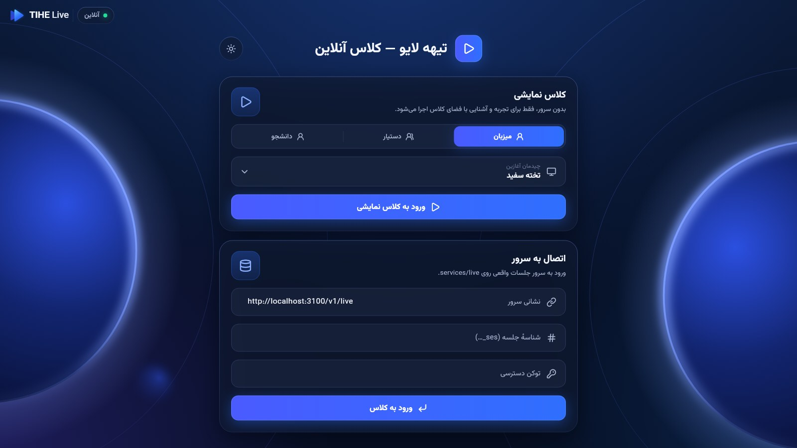 | 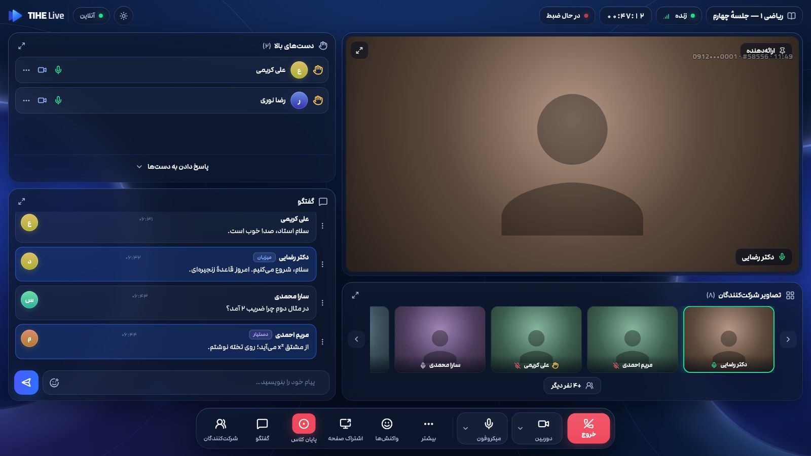 |
| The welcome screen: a demo class or a real one, and the server lamp | Q&A: speaker and film strip, hands and chat |
| 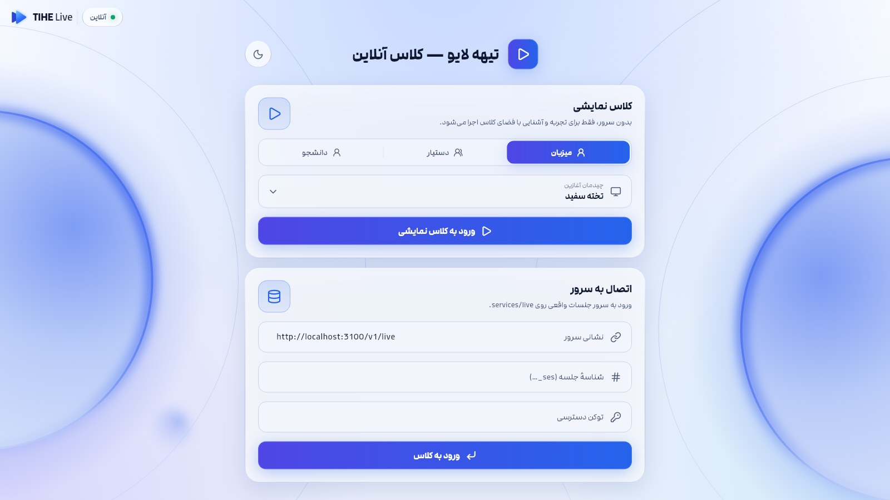 | 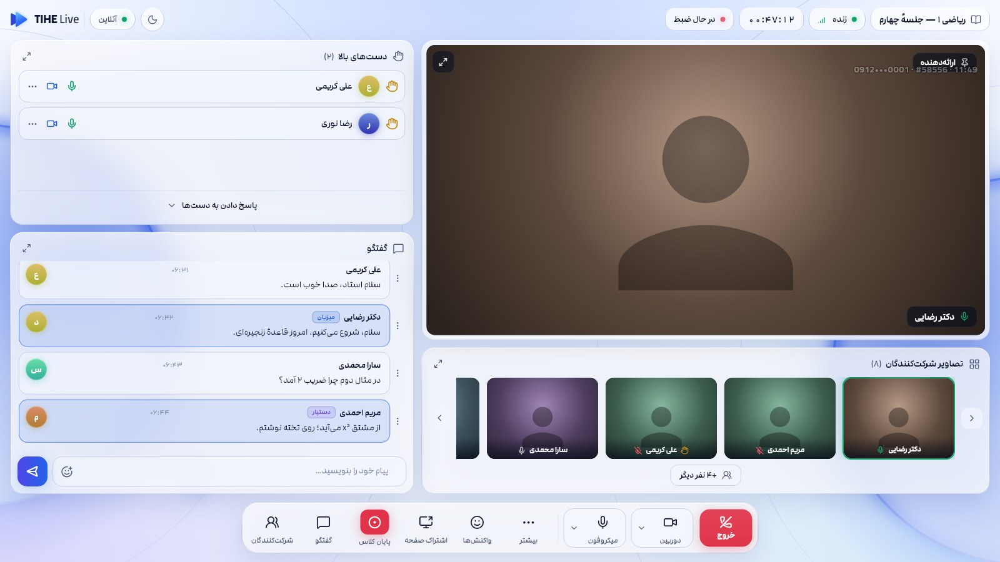 |
| The welcome screen in light | Q&A in light |
| 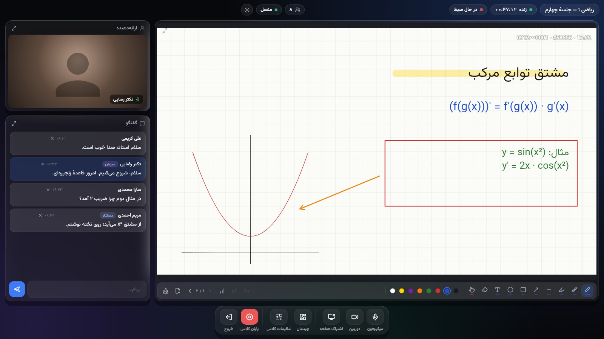 | 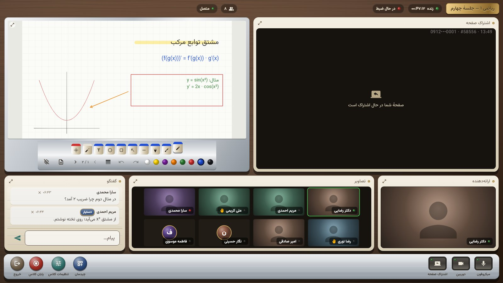 |
| Whiteboard layout: the marker tray, pages, and a raised-hand alert | Split: screen share next to the board |
| 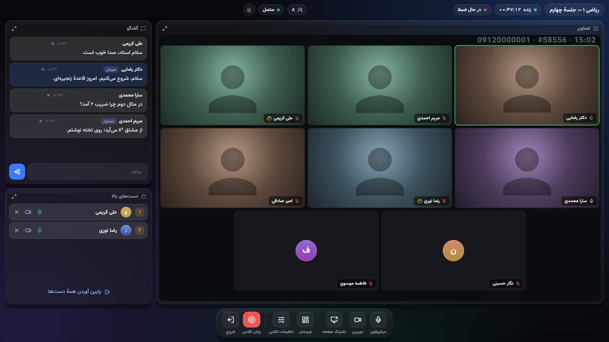 | 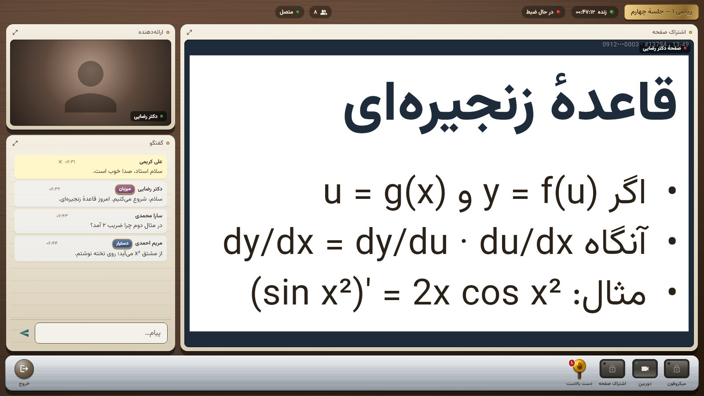 |
| Discussion: gallery, chat, hands queue | A student's view: the watermark sits in a stage corner (since then: name over number, five spots — §9) |
| 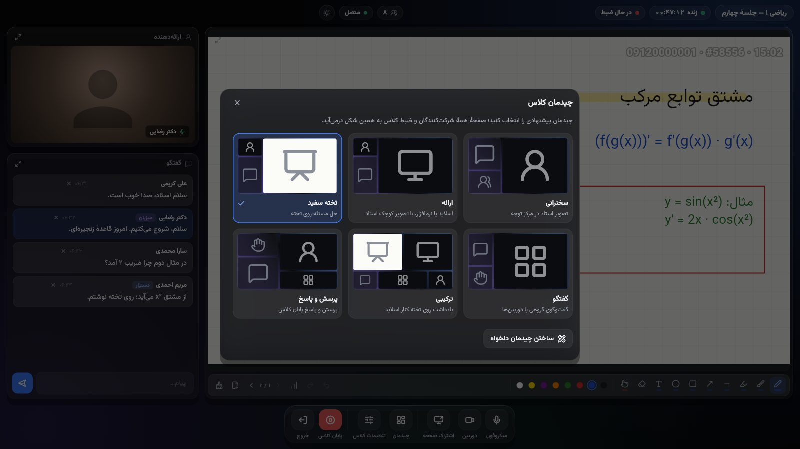 | 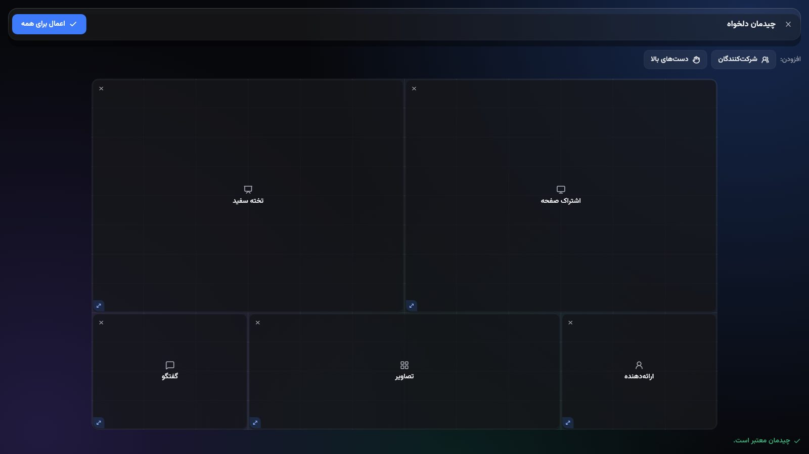 |
| The six recommended layouts | The layout editor on the 12 × 12 grid |
| 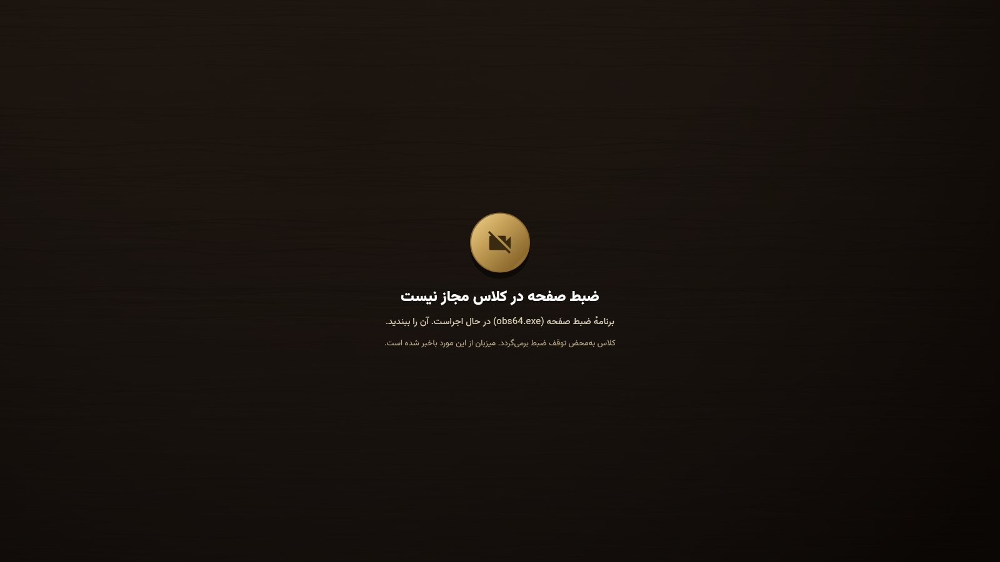 | 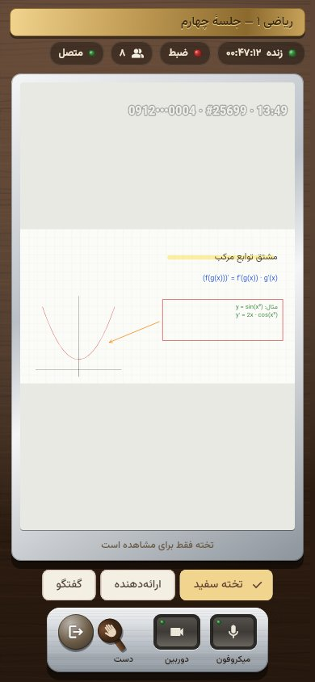 |
| A student's classroom while a recorder runs | Phone width: the largest pod plus tabs |
| 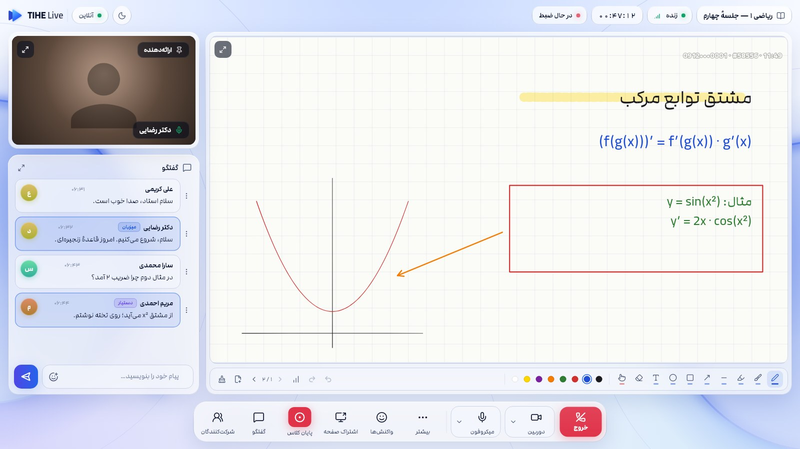 | 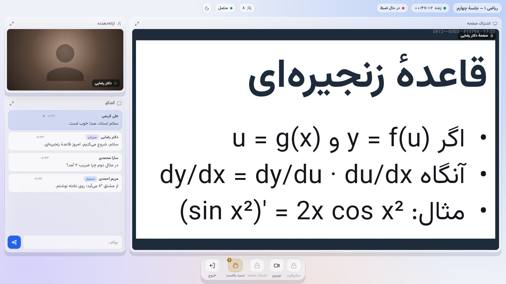 |
| The light theme: the same glass over a pale canvas | A student's view in light |
| 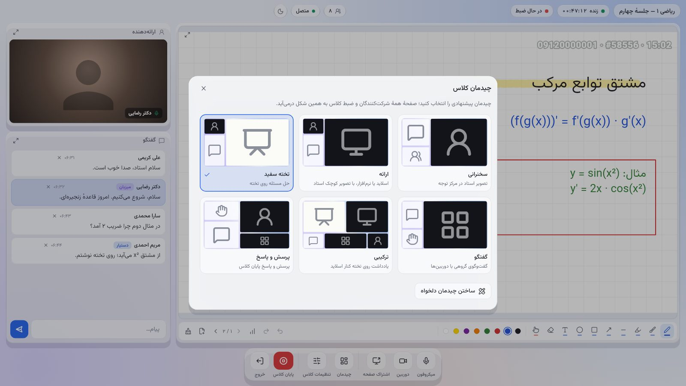 | 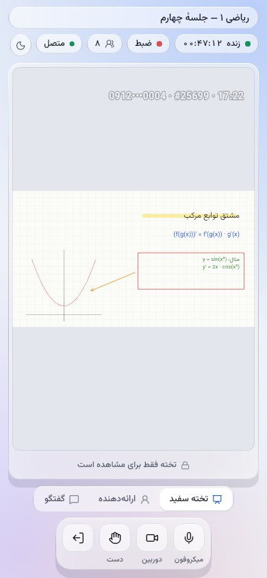 |
| The layout picker in light | Phone width in light |
| 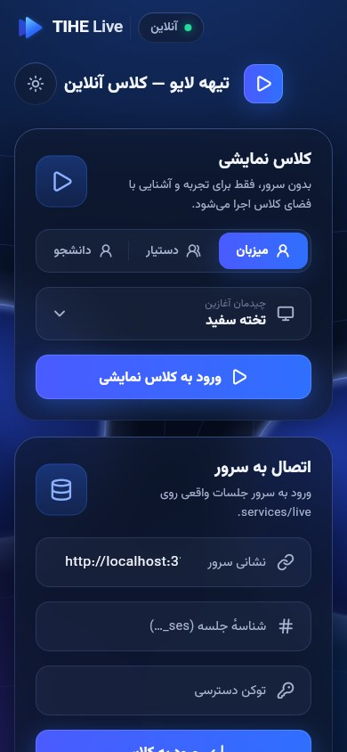 |  |
| The welcome screen on a phone | The cursor, plain and over something clickable, on dark and light |

## 14. Running it end to end

To drive a class by hand:
1. Start services/live in memory (see `services/live/README.md`).
2. Mint a teacher token and a student token with `dev-token`.
3. Create and start a class over REST.
4. Join from the example app (`packages/tihe_classroom/README.md`).

**Verified in a container**, with:
- real `livekit-server` 1.13
- services/live built and running in memory
- the example app as a Linux desktop build

What worked:
- Creating and starting a class created a LiveKit room named after the session.
- Starting the class asked Egress to record, with the template URL and the
  `recordings/{classId}/{sessionId}/composite.mp4` path.
- With no Egress worker running, the request timed out, and the session logged
  `recordingError` rather than failing.
- The app joined the gateway, and the teacher saw the student come online.
- The gateway acknowledged every command the teacher sent.
- A change to the room policy reached the student as a participant update.

Not verified there:
- **The app's media connection.** `livekit_client` on Linux needs NetworkManager over D-Bus,
  which the container lacks.
- **Screen rendering under Xvfb.** The virtual display stopped repainting, so the app's
  screens were checked with the widget tests and the screenshot test instead.

Both need a real desktop, and the device checklist in §12 covers the rest.
